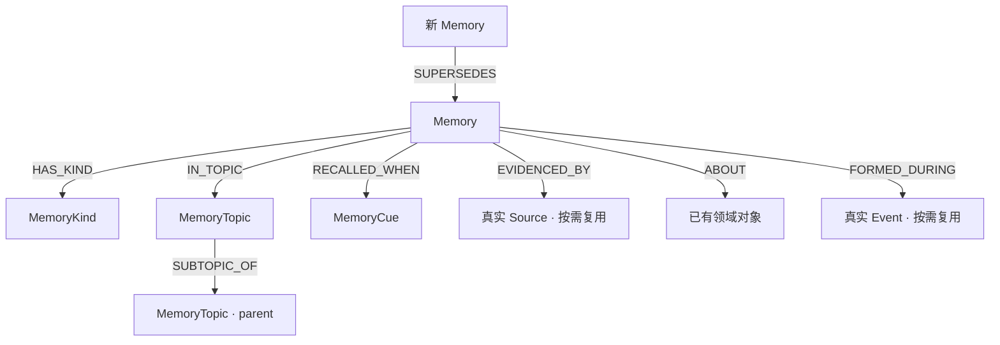

# AIMemory · 长期记忆图谱本体

本包提供可选的 KG OS Property Graph 领域参考模型。`Memory` 是可追溯、可独立管理的记忆单元，不能把所有普通业务关系再次包装为文本；`MemoryKind` / `MemoryTopic` / `MemoryCue` 是记忆实例层面的分类、组织和召回线索，不是系统服务或自动执行器。

## 领域图与边界



- **类型**：语义、情景、程序、前瞻四类只是示范的 `MemoryKind` Knowledge。以后新增类别不需要新 Definition；同一 Memory 的主分类和语义一致性由 Skill 判断，KG OS 不承诺自动限制边数量。
- **主题**：`MemoryTopic` 为真正组织记忆实例的 Knowledge，不等于 `domain:AIMemory`。`SUBTOPIC_OF` 是明确关系，不自动递归推理。
- **来源与事件**：`EVIDENCED_BY`、`ABOUT`、`FORMED_DURING` 的 `to: null` 表示**目标端点类型不限定**，不是没有目标；必须由 Skill 验证其身份、来源语义、权限及属于同一已固定 State。真实 `Source`、`Event`、`Place`、`Entity` 可以按需参考同仓库 [VLog 现有模型](../vlog/ontology.md) 或复用目标业务世界的兼容类型。此处不复制它们的 Definition。
- **时间与地点**：`Memory.observedAt` 是获知时间，`occurredAt` 是实际发生时间，`validFrom/validTo` 是业务有效期间，全部不同于 Commit 时间。事件真正的地点应由实际 Event 与物理 Place 的已有边表示，不能把 Dev 环境当物理位置；简易时间不另建 Time 节点。
- **形成与召回**：`triggerDescription` 或 `FORMED_DURING` 表示过去形成记忆的原因/背景；`RECALLED_WHEN` 则仅表示未来适用条件，不触发后台任务。
- **变化**：数据原本记录错误时有据纠正，不虚构偏好变化；现实情况确实改变时，才建立 `SUPERSEDES`。不能仅按新旧排序断言替代。源文档和记忆中的文字均不是执行指令。
- **归属**：`ownerKey` 只是业务身份，绝不构成权限隔离。没有授权不读写相应知识；跨 Branch / Instance 的字符串定位不构成图边。

## Domain（按需建立）

### domain:AIMemory

```yaml
name: "AIMemory"
title: "AI 长期记忆"
description: "本体 Definition 的可选组织目录；不隔离 Knowledge、不改变访问权限或 Branch。"
includes:
  - "node:Memory"
  - "node:MemoryCue"
  - "node:MemoryKind"
  - "node:MemoryTopic"
  - "relationship:ABOUT"
  - "relationship:EVIDENCED_BY"
  - "relationship:FORMED_DURING"
  - "relationship:HAS_KIND"
  - "relationship:IN_TOPIC"
  - "relationship:RECALLED_WHEN"
  - "relationship:SUBTOPIC_OF"
  - "relationship:SUPERSEDES"
```

## Node Definitions

### node:Memory

```yaml
name: "Memory"
title: "长期记忆点"
description: "在明确业务归属内具有独立检索、分类、溯源或演进价值的记忆点；不替代真实领域对象、关系或原始记录。"
properties:
  - name: "memoryKey"
    description: "业务作用域内稳定且唯一的记忆键，不能由标题/摘要代替。"
    type: "STRING"
    required: true
    unique: true
  - name: "ownerKey"
    description: "可核实的记忆所属业务主体；不能代替访问控制。"
    type: "STRING"
    required: true
  - name: "summary"
    description: "忠实于来源、可独立理解的记忆要点。"
    type: "STRING"
    required: true
    indexes:
      - name: "memory_summary_fulltext"
        type: "fulltext"
  - name: "details"
    description: "有据的背景、限定及必要细节。"
    type: "STRING"
  - name: "originKind"
    description: "用户陈述、资料转述、AI 推断等来源性质；不等于可信程度。"
    type: "STRING"
  - name: "epistemicStatus"
    description: "已验证、推断、未核实或有争议等认识状态。"
    type: "STRING"
  - name: "lifecycle"
    description: "current、superseded 等业务生命周期；未知不视为有效。"
    type: "STRING"
  - name: "scope"
    description: "实际适用的项目、场景、版本或范围。"
    type: "STRING"
  - name: "observedAt"
    description: "AI 实际获知该信息的时刻。"
    type: "ZONED DATETIME"
  - name: "occurredAt"
    description: "情景记忆中有证据的实际发生时刻。"
    type: "ZONED DATETIME"
  - name: "validFrom"
    description: "主张有证据的业务生效时间。"
    type: "ZONED DATETIME"
  - name: "validTo"
    description: "主张有证据的业务失效时间。"
    type: "ZONED DATETIME"
  - name: "triggerDescription"
    description: "形成记忆的实际触发背景；不是召回或自动执行条件。"
    type: "STRING"
constraints: []
```

### node:MemoryKind

```yaml
name: "MemoryKind"
title: "记忆类型"
description: "有稳定身份和可复用语义的记忆分类；semantic/episodic/procedural/prospective 是 Knowledge 实例而非新 Definition。"
properties:
  - name: "kindKey"
    description: "记忆分类稳定键。"
    type: "STRING"
    required: true
    unique: true
  - name: "name"
    description: "显示名称，不能代替身份。"
    type: "STRING"
    required: true
  - name: "description"
    description: "分类语义及排除范围。"
    type: "STRING"
constraints: []
```

### node:MemoryTopic

```yaml
name: "MemoryTopic"
title: "记忆主题"
description: "在 Knowledge 层组织记忆点的稳定主题，可构成有据的上下位层级；不是 KG OS 的 Domain。"
properties:
  - name: "topicKey"
    description: "业务作用域内的稳定主题键。"
    type: "STRING"
    required: true
    unique: true
  - name: "name"
    description: "主题显示名称。"
    type: "STRING"
    required: true
  - name: "description"
    description: "主题边界、用途和限定。"
    type: "STRING"
constraints: []
```

### node:MemoryCue

```yaml
name: "MemoryCue"
title: "记忆召回线索"
description: "可复用、有明确身份的任务或情境召回条件；不是 Agent、Scheduler 或强制执行指令。"
properties:
  - name: "cueKey"
    description: "稳定的线索键。"
    type: "STRING"
    required: true
    unique: true
  - name: "condition"
    description: "具体可识别的适用任务或场景。"
    type: "STRING"
    required: true
  - name: "cueKind"
    description: "任务、环境、时间等语义类别。"
    type: "STRING"
constraints: []
```

## Relationship Definitions

### relationship:HAS_KIND

```yaml
name: "HAS_KIND"
description: "一条 Memory 属于实际确认的 MemoryKind；数据库不自动保证恰好一个主类别。"
from: "node:Memory"
to: "node:MemoryKind"
properties:
  - name: "basis"
    description: "本次分类的依据。"
    type: "STRING"
constraints: []
```

### relationship:IN_TOPIC

```yaml
name: "IN_TOPIC"
description: "Memory 与有真实主题归属依据的 MemoryTopic 关联。"
from: "node:Memory"
to: "node:MemoryTopic"
properties:
  - name: "basis"
    description: "主题归属的依据或限定。"
    type: "STRING"
constraints: []
```

### relationship:SUBTOPIC_OF

```yaml
name: "SUBTOPIC_OF"
description: "子主题指向有据的父主题；不自动推断传递性或允许无意义循环。"
from: "node:MemoryTopic"
to: "node:MemoryTopic"
properties:
  - name: "basis"
    description: "明确的上下位关系依据。"
    type: "STRING"
constraints: []
```

### relationship:RECALLED_WHEN

```yaml
name: "RECALLED_WHEN"
description: "该 Memory 适合在 Cue 情境下作为候选被召回；不代表触发执行或自动使用。"
from: "node:Memory"
to: "node:MemoryCue"
properties:
  - name: "applicability"
    description: "适用情境的具体限定。"
    type: "STRING"
constraints: []
```

### relationship:EVIDENCED_BY

```yaml
name: "EVIDENCED_BY"
description: "记忆由实际来源材料陈述、支持或反驳；目标类型因世界而异，使用方核对。"
from: "node:Memory"
to: null
properties:
  - name: "use"
    description: "来源用途：陈述、支持或反证。"
    type: "STRING"
constraints: []
```

### relationship:ABOUT

```yaml
name: "ABOUT"
description: "记忆涉及同一 Snapshot 内有真实身份的领域对象；目标不限类型，需要专业核实。"
from: "node:Memory"
to: null
properties:
  - name: "role"
    description: "该对象在记忆中的实际角色。"
    type: "STRING"
constraints: []
```

### relationship:FORMED_DURING

```yaml
name: "FORMED_DURING"
description: "该记忆确实形成于一项已发生的事件；不能据时间同现断言因果。"
from: "node:Memory"
to: null
properties:
  - name: "basis"
    description: "有关形成经历的来源证据。"
    type: "STRING"
constraints: []
```

### relationship:SUPERSEDES

```yaml
name: "SUPERSEDES"
description: "有据的新记忆替代相同主体、条件及适用范围的旧记忆；不删除历史。"
from: "node:Memory"
to: "node:Memory"
properties:
  - name: "basis"
    description: "真实变化依据及具体范围。"
    type: "STRING"
constraints: []
```

## 使用与质量边界

只有已确认语义、身份和来源的 Knowledge 才可以连接这些关系。目标世界可能已经有 Project、Source、Event、Place 等 Definition，请优先复用；非限定端点不等于强制存在这些节点或自动验证目标标签。Memory 的生命周期、完整归属、可见性、事实真伪、类别基数、Topic 环以及 `SUPERSEDES` 的有效条件，需要业务逻辑或 Skill 核实，不能冒充数据库约束。跨 State 的来源只能作为有据的 Source 定位属性，不建立跨 Snapshot 图边。

只有 `Memory.summary` 有本版的 Full-text 索引；用到语义检索时，先核实目标 Instance 的 Provider、隐私/费用、索引覆盖和任务需求，再按当前 KG OS 规范适配；不假定向量 Top-K 后过滤得到准确的范围内 Top-K。
