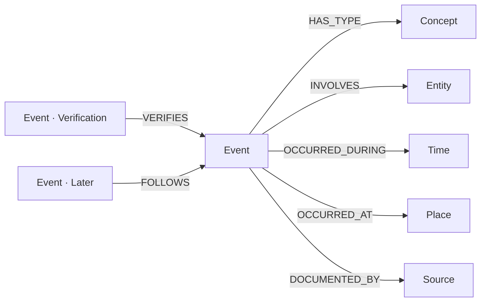

# VLog 事件中心本体参考

**用途**：在已有模型不足以准确记录系统事件及其关联时，为系统事件知识世界（例如 `branch/vlog`）提供一套可复用的 KG OS Property Graph Ontology。模型用于系统记录，不是 Kernel 预置的领域 Schema，不会因为阅读模型或安装 Skill 自动创建；使用前必须核对目标 State 的现有 Definition，实际结构变化遵循 `kgos-ontology-standards` 的具体方案授权规则。

本文件是公开 VLog 模型包**完整 Definition YAML 的唯一维护真源**。每个 `yaml` 代码块恰好是一份 KG OS 可编辑 Node / Relationship Definition body，标题是对应的 Object Ref；不把 Markdown 标题、Object metadata 或代码围栏放入 YAML。使用方 Skill 只能从明确的 Git Commit 生成固定快照，不单独维护第二份模型。运行测试从本文件提取这些代码块。

## 1. 本体论与适用边界

| 概念 | 语义 | 什么时候需要独立节点 |
| --- | --- | --- |
| **Event** | 一次实际发生的事件、操作、决定形成或验证活动 | 每次可区分的发生事实 |
| **Entity** | 持续存在、参与事件或受到影响的对象 | 需要稳定身份及跨事件复用的系统、组织、人员、项目、环境 |
| **Time** | 具有业务身份、范围、精度或可复用的时间表达 | 事件跨时间段、多个事件共享时间窗口或需查询区间 |
| **Place** | 事件发生的真实物理空间位置 | 位置有独立身份或空间查询需求 |
| **Concept** | 事件的语义类型或分类概念 | 部署、故障、验证等分类；新类别通常只新增 Concept 实例 |
| **Source** | 一份能够被独立识别的观察、材料、回执或来源定位 | 来源需复用、追溯、查明由谁/哪个版本提供 |

`Event` 不代表一切知识：任务计划尚未执行时不是一个已发生的运行事件，持续存在的系统也不是 Event。对于“作出决定”可以记录**作出决定这一发生事件**；对计划目标本身应复用适当的既有实体/知识模型，不能假装计划已执行。无需为了完整度强制创建 Time、Place、Source。

### 主要关系



以上关系均为**同一目标 Snapshot 内的真实 Graph Relationship**。外部 Instance/Branch 的 Ref、Commit、URL 等保存在本地 Source 的来源属性中，不自动成为跨 Snapshot 图边。

## 2. Node Definitions

### node:Event

```yaml
name: "Event"
title: "事件"
description: "一次具有可区分身份的实际发生事项，例如故障、部署尝试、作出决定或验证活动。事件的种类通过 HAS_TYPE 关联 Concept。"
properties:
  - name: "eventKey"
    description: "本模型实际身份作用域内稳定且唯一的事件标识，不是摘要或发生时间。"
    type: "STRING"
    required: true
    unique: true
  - name: "summary"
    description: "准确描述已发生的核心事实；不得将计划或未知结果说成成功。"
    type: "STRING"
    required: true
  - name: "details"
    description: "有依据的原因、过程、上下文、影响范围及重要限制。"
    type: "STRING"
  - name: "occurredAt"
    description: "可确认的实际发生时点；区间和共享窗口使用 Time 关联。"
    type: "ZONED DATETIME"
  - name: "observedAt"
    description: "可确认的观察或收到报告时点，区别于事件发生时间。"
    type: "ZONED DATETIME"
  - name: "outcome"
    description: "该事件自身可确认的结果，例如失败、通过或未知，不是全任务状态；取值由调用方语义约定。"
    type: "STRING"
  - name: "scope"
    description: "本次事实的适用环境、影响范围、检查覆盖和遗漏。"
    type: "STRING"
constraints: []
```

### node:Entity

```yaml
name: "Entity"
title: "参与或受影响的对象"
description: "可独立识别并跨事件复用的系统、环境、项目、组织、人员或其他持续存在的对象。"
properties:
  - name: "entityKey"
    description: "在已约定来源与身份作用域内唯一的对象业务键。"
    type: "STRING"
    required: true
    unique: true
  - name: "name"
    description: "供人理解的对象名称，可重名，不作为身份规则。"
    type: "STRING"
    required: true
  - name: "entityKind"
    description: "可选的说明性类别，不代替独立业务身份或物理地点。"
    type: "STRING"
constraints: []
```

### node:Time

```yaml
name: "Time"
title: "时间表达"
description: "需独立定位、被多个事件复用或带范围的时间点/时间段；普通已知时点可以直接记录在 Event.occurredAt。"
properties:
  - name: "timeKey"
    description: "本模型中稳定的时间表达身份，区别于任意时间戳字符串。"
    type: "STRING"
    required: true
    unique: true
  - name: "startAt"
    description: "已知时间范围开始；若为单一时点需明确其语义。"
    type: "ZONED DATETIME"
  - name: "endAt"
    description: "已知时间范围结束；区间边界规则由具体任务确定。"
    type: "ZONED DATETIME"
  - name: "precision"
    description: "实际来源支持的时间精度或区间解释；不得根据存储格式伪造精度。"
    type: "STRING"
constraints: []
```

### node:Place

```yaml
name: "Place"
title: "物理地点"
description: "可独立识别的物理空间位置；云服务环境、Branch 或逻辑系统不属于 Place。"
properties:
  - name: "placeKey"
    description: "本模型的稳定物理地点业务键。"
    type: "STRING"
    required: true
    unique: true
  - name: "name"
    description: "实际地点名称或已核实的空间标识。"
    type: "STRING"
    required: true
  - name: "description"
    description: "已知位置范围或必要说明，不伪造坐标。"
    type: "STRING"
constraints: []
```

### node:Concept

```yaml
name: "Concept"
title: "语义概念"
description: "可复用的事件类型或分类，例如 incident、deployment、verification；新增类别通常只增加 Concept Knowledge。"
properties:
  - name: "conceptKey"
    description: "同一概念词表范围内的稳定键。"
    type: "STRING"
    required: true
    unique: true
  - name: "name"
    description: "概念名称。"
    type: "STRING"
    required: true
  - name: "definition"
    description: "类别适用和排除边界；名称相似不意味着自动推理或同义。"
    type: "STRING"
constraints: []
```

### node:Source

```yaml
name: "Source"
title: "证据与来源"
description: "一次可区分的来源观察、材料版本、报告或操作回执；被引用不意味着主张必然真实。"
properties:
  - name: "sourceKey"
    description: "当前来源身份作用域内稳定且唯一的来源键，不以可变 URL 直接代替快照身份。"
    type: "STRING"
    required: true
    unique: true
  - name: "title"
    description: "已知来源说明；未知时不编造标题。"
    type: "STRING"
  - name: "locator"
    description: "能实际追溯的材料、测试结果或报告位置；缺少稳定链接时可以不提供。"
    type: "STRING"
  - name: "observedAt"
    description: "实际观察/接收来源的时刻。"
    type: "ZONED DATETIME"
  - name: "sourceInstance"
    description: "来源是另一 KG OS 实例时可确认的身份，不从相同 Branch 名猜测。"
    type: "STRING"
  - name: "sourceBranch"
    description: "来源分支的已知上下文，不代替不可变 State。"
    type: "STRING"
  - name: "sourceBeforeState"
    description: "来源操作之前实际确认的 immutable State。"
    type: "STRING"
  - name: "sourceAfterState"
    description: "来源操作之后实际确认的 immutable State。"
    type: "STRING"
  - name: "sourceVerifiedState"
    description: "对应验证实际读取的 immutable State。"
    type: "STRING"
  - name: "sourceObjectRef"
    description: "来源 State 中实际对象的 Ref；只是定位数据，不是本地 Graph Relationship 端点。"
    type: "STRING"
constraints: []
```

## 3. Relationship Definitions

### relationship:HAS_TYPE

```yaml
name: "HAS_TYPE"
description: "事件指向实际适用的分类概念；一个事件可有多个有证据的类别，类别变化不要求新增 Definition。"
from: "node:Event"
to: "node:Concept"
properties:
  - name: "basis"
    type: "STRING"
    description: "本次分类的可说明依据，不作为必须填写的分类证明。"
constraints: []
```

### relationship:INVOLVES

```yaml
name: "INVOLVES"
description: "事件指向参与或实际受到影响的对象，关系属性说明该对象在本事件中的具体角色。"
from: "node:Event"
to: "node:Entity"
properties:
  - name: "role"
    type: "STRING"
    description: "对象在这次事件中的角色或影响，不属于实体的永久属性。"
constraints: []
```

### relationship:OCCURRED_DURING

```yaml
name: "OCCURRED_DURING"
description: "事件与独立时间点/区间的关联；必须有实际时间依据，不能推断严格全序。"
from: "node:Event"
to: "node:Time"
properties:
  - name: "basis"
    type: "STRING"
    description: "为何将事件归入该时间表达的已知依据。"
constraints: []
```

### relationship:OCCURRED_AT

```yaml
name: "OCCURRED_AT"
description: "事件发生于可确认的物理位置；软件环境应通过 INVOLVES 指向 Entity。"
from: "node:Event"
to: "node:Place"
properties:
  - name: "basis"
    type: "STRING"
    description: "实际地点定位或观察的依据。"
constraints: []
```

### relationship:DOCUMENTED_BY

```yaml
name: "DOCUMENTED_BY"
description: "事件有一份可追溯的来源或观察记录，不自动证明该来源的主张正确。"
from: "node:Event"
to: "node:Source"
properties:
  - name: "use"
    type: "STRING"
    description: "该来源在这次记录中的用途，如报告、支持或反证；不代表内容必然真实。"
constraints: []
```

### relationship:VERIFIES

```yaml
name: "VERIFIES"
description: "作为验证活动的 Event 指向被验证的 Event；源/目标版本、范围与结论仍须独立核实。"
from: "node:Event"
to: "node:Event"
properties:
  - name: "scope"
    type: "STRING"
    description: "此次验证与被验证事件关联的实际范围或版本限定。"
constraints: []
```

### relationship:FOLLOWS

```yaml
name: "FOLLOWS"
description: "较晚的 Event 指向有证据确认先于它发生的 Event；不是因果或自动传递关系。"
from: "node:Event"
to: "node:Event"
properties:
  - name: "basis"
    type: "STRING"
    description: "已知先后关系的依据，不表示因果。"
constraints: []
```

## 4. 实际使用和演进规则

- 以上六个 Node Definition、七个 Relationship Definition 是**一套参考模型**，不代表用户库预置了这些类型，也不应强行迁移已有结构。只在真实目标需要且既有模型不足时，按 `kgos-ontology-standards` 的具体方案授权规则选用必要的 Definition；不能因示例而重复定义已有实体。
- KG OS 当前 Definition 合同要求至少一个 Property，因此每种 Relationship 提供了一个有业务用途但**非必填**的关系属性。并不要求每条边都填写 `basis`、`scope` 或 `use`，也不把这些属性当作数据库已独立核实的事实。
- 具体事件类别（如 `security-incident`、`deployment`、`verification`）以 `Concept` 实例表示；用 `HAS_TYPE` 关联 Event。新增类别、记录和对象属于 Knowledge 更新，**无需修改 Ontology**；只有结构语义或约束的真实缺口才演进 Definition。
- `FOLLOWS` 仅表示有证据的先后，不等于 `CAUSED_BY`；`VERIFIES` 的存在不证明验证通过，结论必须来自验证 Event 自身及证据；`DOCUMENTED_BY` 不代表来源独立或真实。
- 需要记录一次修复多次尝试时，每次确实发生的尝试是独立 Event，可共享相关 Entity 与 Concept，通过必要的 `FOLLOWS`、`VERIFIES` 关联；不创建固定 Task/Run/Verification 专用 Definition。没有独立身份的原始结果可以留作 Event 的 Property。
- 时间不要求每次建 Time 节点；环境不当作 Place；跨 Branch/Instance 仅保存来源定位，不构造不存在的跨快照关系。版本化历史只能证明“当时记录了什么”，不自动证明业务事实为真。
- Node 唯一性只覆盖所在实际模型约束作用域，不意味着全账户或跨 Instance 唯一。关系类型和端点由 KG OS 真实 Schema 执行；Source 真实性、证据关联、状态词、时间合理性、`VERIFIES` 目标的业务适用性、FOLLOWS 的事实先后仍需 Agent/应用核实，不虚报数据库自动证明。
- 根据实际 `kgos_docs` 读取目标 State 的完整 Definition，按当前 canonical YAML 和获准范围执行必要 Patch；先读取模型与已有 Knowledge，再按需调整。本文件不是可直接作为一次 `kgos_mutate` 请求整体执行的补丁。
